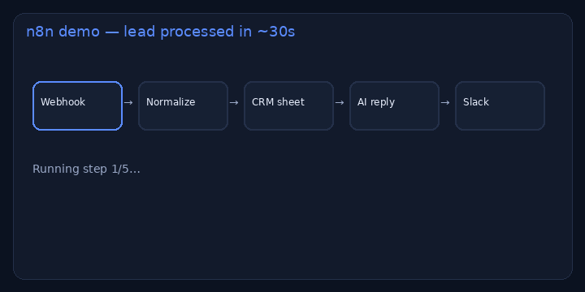

# n8n AI workflow gallery

> **For non-technical clients — start here**
>
> **What it does:** Connects your tools so a new lead (or invoice, or support mail) is handled automatically — sheet updated, AI draft ready, Slack pinged.
>
> **Try it in 1 click:** open the [**live simulator**](https://nyyoautomation.github.io/nyyo-n8n-workflows/), click **Run workflow**, watch the steps and JSON.
>
> **Business benefit:** sales reacts in seconds instead of hours. Workflows from **$100**, agents from **$500**.

**Live:** https://nyyoautomation.github.io/nyyo-n8n-workflows/  
**Brand:** [Nyyo Automation](https://github.com/nyyoautomation)

## What’s for sale
| | |
|---|---|
| Workflow | from **$100–400** |
| AI agent | from **$500** |
| Maintenance | **$150–200/mo** |

→ [Hire on LaborX](https://laborx.com/freelancers/users/id475124) · [Profile](https://github.com/nyyoautomation)
